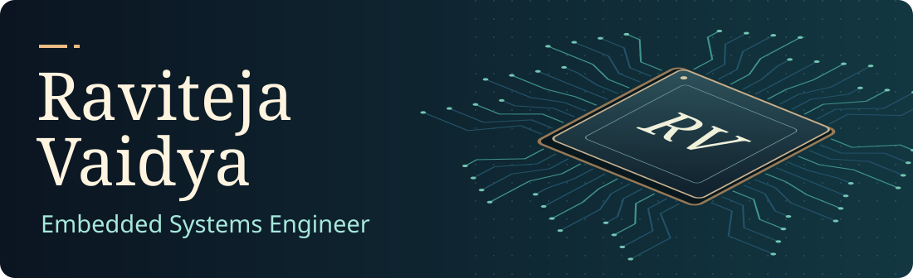
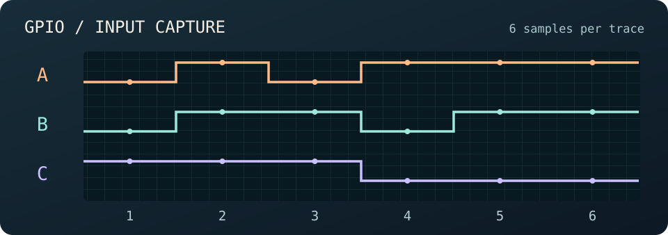

I’m Raviteja, an **Embedded Systems Engineer**. I use this space to explore the details of firmware, from the moment a pin changes state to the way a microcontroller measures and communicates.

[STM32 projects](#stm32-projects) · [Embedded C examples](https://github.com/VaidyaRaviteja/embedded-c-learning/tree/main/embedded-c) · [LinkedIn](https://www.linkedin.com/in/raviteja-vaidya/)

## Would the firmware register a press?

A button can briefly switch between high and low as its contacts settle. My C example starts at **low (0)** and accepts a change after **three consecutive samples** at the opposite level. Each row below is a separate run. Which rows register a press, and which one also registers a release?

<strong>Trace A</strong> · <code>0 1 0 1 1 1</code> · Reveal result

**Press at sample 6.** The low at sample 3 clears the counter. Samples 4, 5, and 6 then supply the three consecutive highs. This is the input sequence in the original program.

<strong>Trace B</strong> · <code>0 1 1 0 1 1</code> · Reveal result

**The accepted state stays low.** Four samples are high in total, but the low at sample 4 splits them into pairs. The program prints no state change.

<strong>Trace C</strong> · <code>1 1 1 0 0 0</code> · Reveal result

**Press at sample 3. Release at sample 6.** After accepting the high, the same rule works in reverse. The next three lows confirm the release.

[Read the debounce implementation in C](https://github.com/VaidyaRaviteja/embedded-c-learning/blob/main/embedded-c/gpio_button_debounce.c)

## STM32 projects

| Start with a question | Open the project |
| --- | --- |
| How does firmware drive an LED? | [First blink](https://github.com/VaidyaRaviteja/STM32-Learning/tree/main/MyFirstBlink) · [GPIO](https://github.com/VaidyaRaviteja/STM32-Learning/tree/main/GPIO) |
| How does a voltage become a number? | [Analog-to-digital conversion](https://github.com/VaidyaRaviteja/STM32-Learning/tree/main/ADC) |
| How does a microcontroller send serial data? | [UART communication](https://github.com/VaidyaRaviteja/STM32-Learning/tree/main/UART) |

For a closer look at timing and events, explore my [timer prescaler](https://github.com/VaidyaRaviteja/embedded-c-learning/blob/main/embedded-c/timer_prescaler.c) and [interrupt flag](https://github.com/VaidyaRaviteja/embedded-c-learning/blob/main/embedded-c/interrupt_flag_handling.c) examples.
