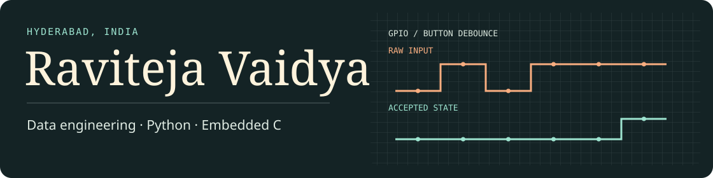

I’m Raviteja, a computer science graduate in Hyderabad. Two questions show up in my projects: **Did the right data arrive?** And **did that input really change?** I explore the first with Python and SQL, and the second with C and STM32.

## Inside the Spotify pipeline

Once the track data reaches S3, the Airflow workflow branches. One task triggers a Databricks job. Another runs a Glue crawler and queries Athena. Later, a comparison task reads track and album counts from Athena and Snowflake so the two results can be checked against each other.

[Read the Airflow workflow](https://github.com/VaidyaRaviteja/spotify-etl-data-engineering/blob/main/dags/spotify_etl_dag.py) · [Explore the architecture](https://github.com/VaidyaRaviteja/spotify-etl-data-engineering/tree/main/architecture) · [Open the implementation guide](https://github.com/VaidyaRaviteja/spotify-etl-data-engineering/blob/main/IMPLEMENTATION_GUIDE.md)

## How to read the header

The orange trace is the simulated button input from my C exercise. Read the six dots from left to right: `0 1 0 1 1 1`. The first high disappears on the next sample. The final three highs agree, so the green trace changes on the sixth sample. That one decision is the whole debounce example.

[Read the C example](https://github.com/VaidyaRaviteja/embedded-c-learning/blob/main/embedded-c/gpio_button_debounce.c) · [Explore the STM32 GPIO project](https://github.com/VaidyaRaviteja/STM32-Learning/tree/main/GPIO)

## Two more pieces of code worth opening

| Question | Where to look |
| --- | --- |
| Which month had the highest average transaction value in each year? | My retail SQL query groups sales by year and month, then ranks the monthly averages within each year. [Read the window function](https://github.com/VaidyaRaviteja/Data-Analysis/blob/main/Retail%20Sales%20Analysis%20-%20P1#L151). |
| What happens when an employee ID is missing? | The Django detail view uses `get_object_or_404`. A valid ID sends the employee record to the template. A missing record returns a 404. [Read the view](https://github.com/VaidyaRaviteja/DJANGO/blob/main/Employees/app/views.py). |

I’m open to collaborating on data analysis and machine learning projects. [Find me on LinkedIn](https://www.linkedin.com/in/raviteja-vaidya/).
